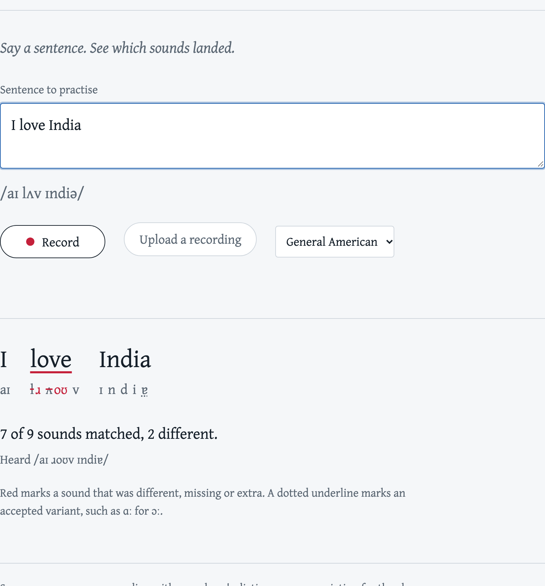

# enunciate

[](https://github.com/Us2id/enunciate/actions/workflows/ci.yml)
[](LICENSE)


Phoneme-level English pronunciation feedback. Give it a recording and the
sentence the speaker meant to say; it tells you which words and which sounds
were off, and why.



Speech-to-text tools cannot do this job: a recogniser trained to produce
sentences will quietly turn "I rove India" into "I love India" and report a
perfect match. enunciate instead runs a model that writes down the sounds it
hears, with no language model to correct them, and compares those sounds with
the dictionary pronunciation of the target sentence.

## What it does

1. **Hears phonemes.** [`facebook/wav2vec2-lv-60-espeak-cv-ft`](https://huggingface.co/facebook/wav2vec2-lv-60-espeak-cv-ft)
   turns the audio into a sequence of IPA symbols with timings.
2. **Knows the target.** [espeak-ng](https://github.com/espeak-ng/espeak-ng)
   gives the expected phonemes for each word, with sentence context, using the
   same symbol set the model was trained on.
3. **Aligns the two** with an edit-distance alignment whose costs know about
   English: flapped t, the cot–caught merger, linking r and a few other regular
   features of spoken General American are accepted rather than penalised, and
   every accepted difference is still reported.
4. **Scores every word** as the share of its sounds that matched, plus an
   overall score of `1 - phoneme error rate`.

It ships as a Python library, a command-line tool, an HTTP API and a browser
page that records from the microphone. English only for now (General American
or British reference pronunciation); the model itself is multilingual.

## Quick start

You need Python 3.11+ and espeak-ng:

```sh
brew install espeak-ng               # macOS
sudo apt-get install espeak-ng       # Debian or Ubuntu
```

Install from GitHub (on Linux, install the CPU build of torch first unless you
want the multi-gigabyte CUDA wheel):

```sh
pip install torch --index-url https://download.pytorch.org/whl/cpu   # Linux only
pip install "enunciate[server] @ git+https://github.com/Us2id/enunciate"
```

The model (1.3 GB) is downloaded from the Hugging Face Hub on first use and
cached under `~/.cache/huggingface`.

### Command line

```
$ enunciate assess clip.flac "Nor is Mister Quilter's manner less interesting than his matter"
Score 0.95: 42 of 43 sounds matched, 1 different, 1 extra

  Nor          n ɔː ɹ             n ɔː ɹ ɹ             (+ɹ)
  is           ɪ z                ɪ z
  Mister       m ɪ s t ɚ          m ɪ s t ɚ
  Quilter's    k w ɪ l t ɚ z      k w ɪ l t ɚ z
  manner       m æ n ɚ            m æ n ɚ
  less         l ɛ s              l ɛ s
  interesting  ɪ n t ɹ ɛ s t ɪ ŋ  ɪ n t ɚ ɹ ɛ s t ɪ ŋ  +ɚ  (0.89)
  than         ð ɐ n              ð æ n                ɐ→æ  (0.67)
  his          h ɪ z              h ɪ z
  matter       m æ ɾ ɚ            m æ ɾ ɚ

Heard: n ɔː ɹ ɹ ɪ z m ɪ s t ɚ k w ɪ l t ɚ z m æ n ɚ l ɛ s ɪ n t ɚ ɹ ɛ s t ɪ ŋ ð æ n h ɪ z m æ ɾ ɚ
Differences in parentheses are accepted variants.
```

That clip is `tests/fixtures/1272-128104-0001.flac`, a LibriSpeech recording.
The reader says "in-ter-est-ing" with four syllables where the dictionary has
three, and "than" with a full vowel; both are reported, neither is a
mispronunciation, and that is the kind of judgement the tool leaves to you.

A synthetic voice saying "I rove India" against the target "I love India":

```
Score 0.78: 7 of 9 sounds matched, 2 different

  I      aɪ         aɪ
  love   l ʌ v      ɹ oʊ v     l→ɹ ʌ→oʊ  (0.33)
  India  ɪ n d i ə  ɪ n d i ɐ  (ə≈ɐ)
```

Other commands:

```sh
enunciate assess clip.wav "text" --json        # full result as JSON
enunciate assess clip.wav "text" --strict      # no accepted variants
enunciate assess clip.wav "text" --voice en-gb # British reference pronunciation
enunciate phonemes "the car"                   # expected pronunciation only
enunciate serve --port 8000                    # API and browser demo
```

### Browser demo and API

`enunciate serve` starts the API with the demo page at `http://127.0.0.1:8000/`
and interactive API docs at `/docs`. The page records from the microphone,
converts the recording to 16 kHz WAV in the browser and posts it to the API;
the server never needs ffmpeg.

```sh
curl -F "text=I love India" -F "audio=@clip.wav" http://127.0.0.1:8000/api/assess
```

```json
{
  "text": "I love India",
  "score": 0.7778,
  "phoneme_error_rate": 0.2222,
  "words": [
    {"word": "love", "score": 0.3333, "expected": ["l", "ʌ", "v"],
     "phonemes": [
       {"op": "substitute", "expected": "l", "heard": "ɹ", "accepted": false, "start": 0.16, "end": 0.18},
       {"op": "substitute", "expected": "ʌ", "heard": "oʊ", "accepted": false, "start": 0.22, "end": 0.24},
       {"op": "match", "expected": "v", "heard": "v", "accepted": true, "start": 0.34, "end": 0.36}
     ]}
  ]
}
```

Also available: `GET /api/phonemes?text=...` for the expected pronunciation and
`GET /healthz`, which reports whether the model is loaded.

### Python

```python
from enunciate import assess

result = assess("clip.wav", "I love India")
print(result.score)  # 0.7778
for word in result.words:
    print(word.word, word.score, " ".join(word.heard))
```

`Assessor`, `Recognizer` and `Phonemizer` are the building blocks if you want
to keep one loaded model and score many recordings, swap the variant rules, or
score phoneme sequences you obtained elsewhere.

## How well does it work?

`scripts/evaluate.py` runs the pipeline over 73 LibriSpeech dev-clean
utterances (481 seconds of clean, native read speech, 4,283 expected phonemes)
and compares what the model heard with espeak-ng's pronunciation of the
transcript. On clean native speech the phoneme error rate is therefore an
upper bound on recogniser error, since it also counts legitimate pronunciation
variants.

| | strict | with accepted variants |
| --- | --- | --- |
| phoneme error rate | 7.8% | 4.9% |
| substitutions / deletions / insertions | 5.1% / 1.8% / 0.8% | 2.8% / 1.6% / 0.4% |
| words scoring at least 0.8 | 85.7% | 90.8% |
| words scoring 1.0 | 77.0% | 84.5% |

Inference took 24 seconds for those 481 seconds of audio on an Apple M5 CPU
(0.05× real time); a typical sentence scores in well under a second. The model
loads in about two seconds from the local cache.

What remains after the variant rules is mostly connected-speech reduction of
function words ("his" without its h, "and" without its d, "the" said as ðɪ
before a consonant). Those are not mispronunciations, and handling weak forms is
the first item on the roadmap. [docs/how-it-works.md](docs/how-it-works.md)
explains how the rules were derived and what each one forgives.

## Limitations

- Scores measure distance from espeak-ng's dictionary pronunciation for the
  chosen accent. Choose `en-gb` for British speakers; Indian, Australian and
  other Englishes have no reference voice yet, so some of their vowels will be
  flagged.
- Weak forms of function words are flagged (see above).
- The recogniser makes its own mistakes, about 5 sounds in 100 on clean native
  speech with the variant rules on. Treat scores as feedback, not grades.
- Homographs ("read", "live") and unusual names get whichever pronunciation
  espeak-ng guesses.
- Nothing about rhythm, stress or intonation is scored.

## Configuration

Every setting has an environment variable; command-line flags override them.

| Variable | Default | Meaning |
| --- | --- | --- |
| `ENUNCIATE_MODEL` | `facebook/wav2vec2-lv-60-espeak-cv-ft` | Hugging Face model id or local path |
| `ENUNCIATE_DEVICE` | `auto` | `cpu`, `cuda`, `mps`; `auto` picks the best available |
| `ENUNCIATE_VOICE` | `en-us` | reference accent, `en-us` or `en-gb` |
| `ENUNCIATE_ESPEAK` | `espeak-ng` | path to the espeak-ng binary |
| `ENUNCIATE_ACCEPT_VARIANTS` | `1` | `0` to penalise every difference |
| `ENUNCIATE_MAX_AUDIO_SECONDS` | `30` | longer recordings are rejected |
| `ENUNCIATE_MIN_AUDIO_SECONDS` | `0.2` | shorter recordings are rejected |
| `ENUNCIATE_MAX_UPLOAD_MB` | `10` | API upload limit |
| `ENUNCIATE_MAX_TEXT_CHARS` | `500` | longest sentence accepted |
| `ENUNCIATE_PRELOAD_MODEL` | `1` | load and prime the model at server start |
| `ENUNCIATE_CORS_ORIGINS` | empty | comma-separated origins allowed to call the API from a browser |

## Deployment

The Dockerfile builds a CPU-only image with espeak-ng and, by default, the
model baked in, so a container starts with no network access:

```sh
docker build -t enunciate .
docker run --rm -p 8000:8000 enunciate
```

The image is about 1.7 GB without the model and 1.3 GB more with it. Build
with `--build-arg PRELOAD_MODEL=0` to leave the model out and mount a Hugging
Face cache at `/home/app/.cache/huggingface` instead, with `HF_HUB_OFFLINE=1`
if the container has no network. The container runs as an unprivileged user and
exposes `/healthz` for readiness.

One process scores one recording at a time, in a worker thread, so the event
loop stays responsive while a request is in flight. For more throughput run
several processes behind a load balancer; each needs about 2 GB of memory for
the model.

## Development

```sh
git clone https://github.com/Us2id/enunciate && cd enunciate
python -m venv .venv && source .venv/bin/activate
pip install torch --index-url https://download.pytorch.org/whl/cpu   # Linux only
pip install -e ".[dev]"
pre-commit install

make lint typecheck test   # ruff, mypy, unit tests with fakes (no model needed)
make integration           # real model on the LibriSpeech fixtures
make evaluate              # the table above
```

Unit tests cover alignment, scoring, espeak-ng output parsing, audio decoding,
the API and the CLI without the model or espeak-ng, using recorded espeak-ng
output and a fake recogniser. CI runs them on Python 3.11 to 3.13, then the
integration tests with the real model and a Docker build on pushes to `main`.

## Roadmap

- Weak forms of function words as alternative pronunciations in the alignment.
- Confidence per phoneme from CTC forced alignment (goodness of pronunciation),
  so a borderline sound can be told apart from a clearly wrong one.
- Phonetic-distance-weighted alignment, so ʃ for s costs less than k for s.
- Other languages: the model is multilingual, so this is mostly an espeak-ng
  voice and a variant table per language.
- A smaller or quantised model for faster CPU inference.
- Evaluation on learner speech (L2-ARCTIC, speechocean762) rather than native
  speech only.

## Acknowledgements

- Qiantong Xu, Alexei Baevski and Michael Auli, *Simple and Effective Zero-shot
  Cross-lingual Phoneme Recognition* (2021), and the released
  `wav2vec2-lv-60-espeak-cv-ft` checkpoint (Apache-2.0).
- [espeak-ng](https://github.com/espeak-ng/espeak-ng) for pronunciations.
- Test fixtures are two utterances from LibriSpeech (Panayotov et al., 2015),
  CC BY 4.0; see `tests/fixtures/README.md`.

## License

MIT. See [LICENSE](LICENSE).
